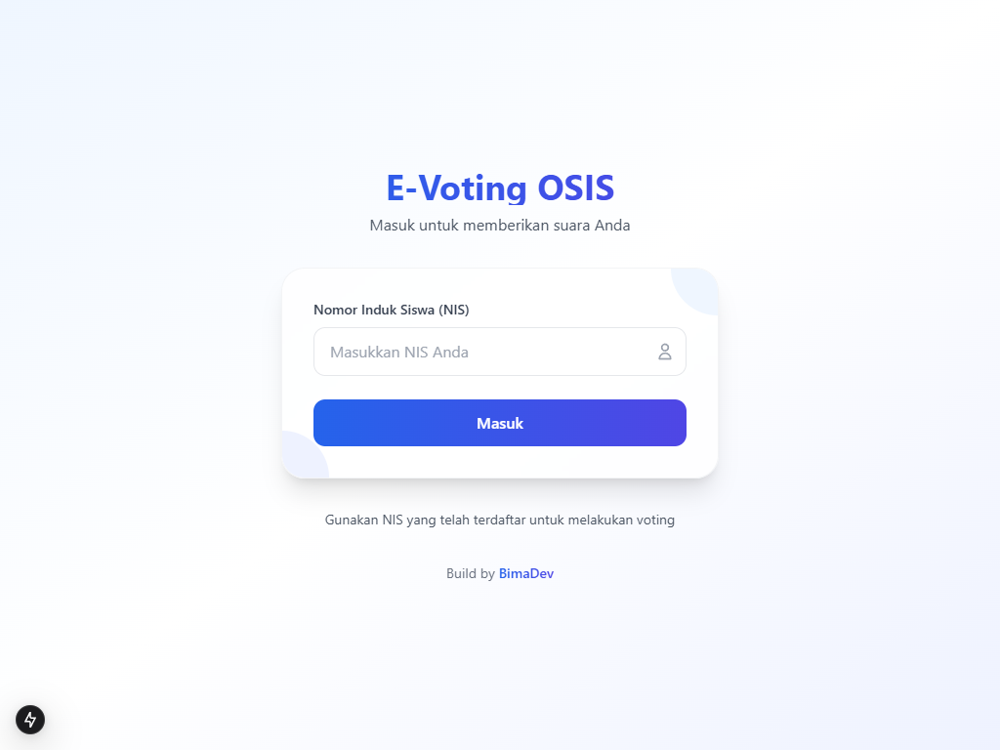
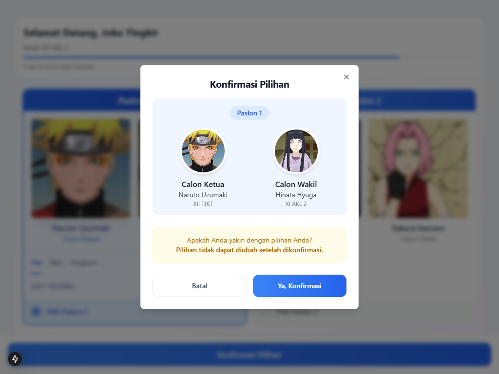
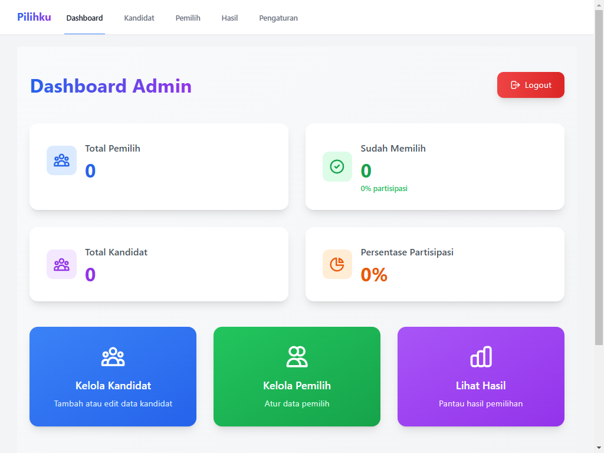
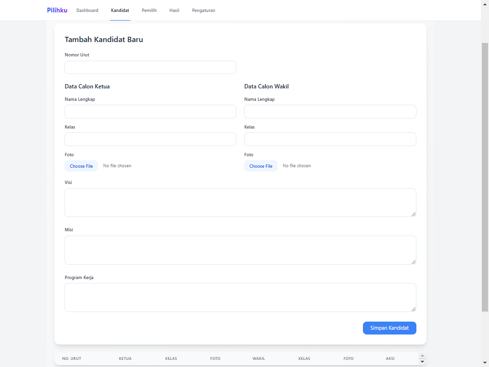
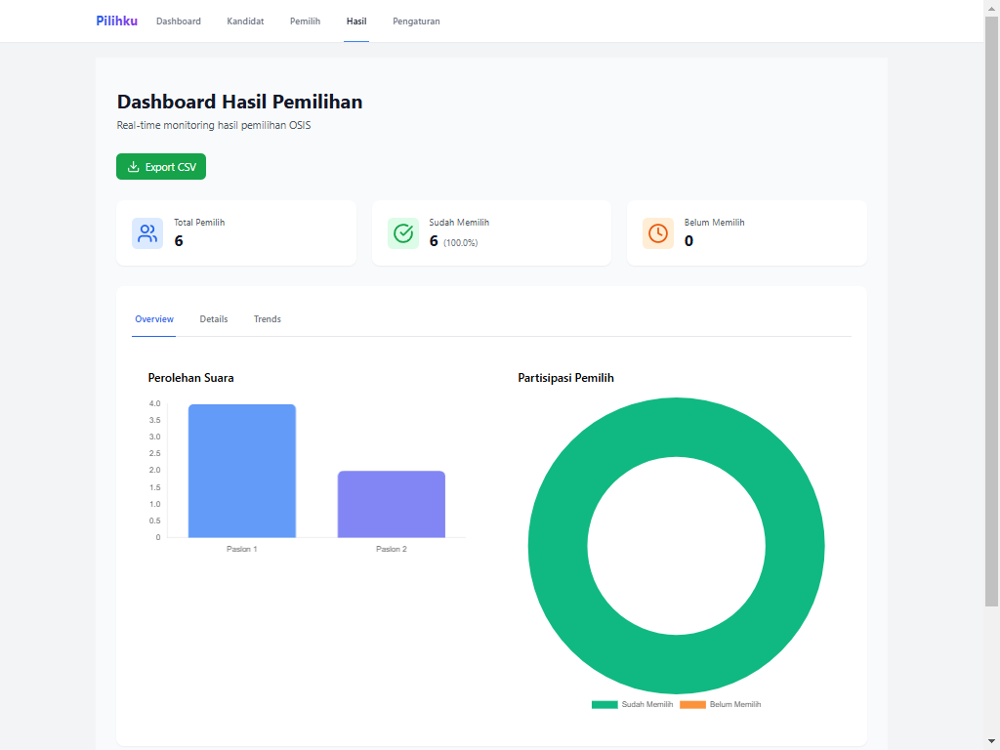
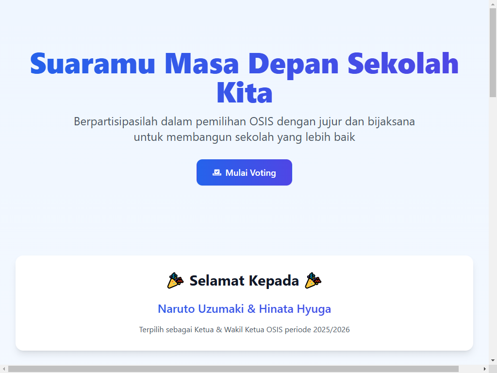

# PilihKu - Sistem E-Voting OSIS

PilihKu adalah aplikasi e-voting modern untuk pemilihan ketua dan wakil ketua OSIS di sekolah. Dibangun dengan Next.js 14, Supabase, Tailwind CSS, dan berbagai teknologi modern lainnya.

## 📸 Preview

<div align="center">
  <h3>Halaman Login</h3>
  
  
  <h3>Halaman Voting</h3>
  
  
  <h3>Dashboard Admin</h3>
  
  
  <h3>Manajemen Kandidat</h3>
  
  
  <h3>Hasil Voting</h3>
  
  
  <h3>Pengumuman Pemenang</h3>
  
</div>

## 🌟 Fitur Utama

### Untuk Pemilih
- Login dengan NIS
- Melihat profil lengkap kandidat (foto, visi, misi, program kerja)
- Melakukan voting dengan konfirmasi
- Halaman terima kasih setelah voting
- Tidak bisa voting lebih dari sekali
- Tampilan responsif untuk mobile dan desktop

### Untuk Admin
- Dashboard admin yang komprehensif dengan statistik real-time
- Manajemen data kandidat (CRUD)
- Manajemen data pemilih (CRUD)
- Import data pemilih via CSV
- Monitoring hasil voting real-time
- Export hasil dalam format CSV
- Cetak laporan hasil pemilihan
- Pengaturan waktu pengumuman pemenang
- Pengumuman pemenang otomatis berdasarkan suara terbanyak
- Reset pengaturan pengumuman

### Fitur Pengumuman
- Countdown timer untuk pengumuman pemenang
- Tampilan animasi dan confetti saat pengumuman
- Pengumuman otomatis pada waktu yang ditentukan
- Pemenang ditentukan berdasarkan jumlah suara terbanyak
- Pengumuman bisa direset atau dihapus


## 🛠 Teknologi yang Digunakan

- **Frontend**:
  - Next.js 14 (App Router)
  - React & TypeScript
  - Tailwind CSS
  - Framer Motion (animasi)
  - React Icons

- **Backend & Database**:
  - Supabase (Database, Auth, Storage)
  - Row Level Security (RLS)

- **Visualisasi Data**:
  - Chart.js

- **Utilitas**:
  - Papa Parse (CSV parsing)


## 📋 Prasyarat

- Node.js versi 18.0.0 atau lebih tinggi
- NPM atau Yarn
- Akun Supabase

## 🚀 Cara Instalasi

1. Clone repository
```bash
git clone https://github.com/bimadevs/pilihku-E-Voting.git
cd pilihku
```

2. Install dependencies
```bash
npm install
# atau
yarn install
```

3. Setup environment variables
```bash
cp .env.example .env.local
```

4. Isi environment variables di .env.local
```bash
NEXT_PUBLIC_SUPABASE_URL=your_supabase_url
NEXT_PUBLIC_SUPABASE_ANON_KEY=your_supabase_anon_key
```

5. Jalankan aplikasi
```bash
npm run dev
# atau
yarn dev
```

## 💾 Setup Database Supabase (Sekali Copy-Paste)

> **Cara Cepat:** Buka **Supabase Dashboard** > pilih proyek Anda > buka menu **SQL Editor** > salin seluruh query SQL di bawah ini, lalu klik tombol **Run**.
>
> *(Query ini juga tersedia di file [`supabase_setup.sql`](./supabase_setup.sql))*

```sql
-- ==============================================================================
-- PILIHKU E-VOTING: SETUP LENGKAP DATABASE & ROW LEVEL SECURITY (RLS) SUPABASE
-- ==============================================================================

-- 0. AKTIFKAN EKSTENSI UUID
CREATE EXTENSION IF NOT EXISTS "uuid-ossp";

-- ==============================================================================
-- 1. PEMBUATAN TABEL & RELASI
-- ==============================================================================

-- Tabel Candidates (Data Pasangan Calon Ketua & Wakil OSIS)
CREATE TABLE IF NOT EXISTS public.candidates (
  id uuid NOT NULL DEFAULT extensions.uuid_generate_v4(),
  candidate_number integer NOT NULL,
  ketua_name text NOT NULL,
  wakil_name text NOT NULL,
  visi text NOT NULL,
  misi text NOT NULL,
  photo_url text NULL,
  created_at timestamp with time zone NOT NULL DEFAULT timezone('utc'::text, now()),
  ketua_photo_url text NULL,
  wakil_photo_url text NULL,
  ketua_class text NULL,
  wakil_class text NULL,
  program_kerja text NULL,
  CONSTRAINT candidates_pkey PRIMARY KEY (id)
) TABLESPACE pg_default;

CREATE UNIQUE INDEX IF NOT EXISTS candidates_candidate_number_key 
ON public.candidates USING btree (candidate_number) TABLESPACE pg_default;


-- Tabel Voters (Daftar Pemilih Tetap / Siswa)
CREATE TABLE IF NOT EXISTS public.voters (
  id uuid NOT NULL DEFAULT extensions.uuid_generate_v4(),
  nis text NOT NULL,
  full_name text NOT NULL,
  class text NOT NULL,
  has_voted boolean NULL DEFAULT false,
  created_at timestamp with time zone NOT NULL DEFAULT timezone('utc'::text, now()),
  CONSTRAINT voters_pkey PRIMARY KEY (id),
  CONSTRAINT voters_nis_key UNIQUE (nis)
) TABLESPACE pg_default;


-- Tabel Votes (Surat Suara Masuk)
CREATE TABLE IF NOT EXISTS public.votes (
  id uuid NOT NULL DEFAULT extensions.uuid_generate_v4(),
  voter_id uuid NULL,
  candidate_id uuid NULL,
  created_at timestamp with time zone NOT NULL DEFAULT timezone('utc'::text, now()),
  CONSTRAINT votes_pkey PRIMARY KEY (id),
  CONSTRAINT votes_candidate_id_fkey FOREIGN KEY (candidate_id) REFERENCES public.candidates (id) ON DELETE CASCADE,
  CONSTRAINT votes_voter_id_fkey FOREIGN KEY (voter_id) REFERENCES public.voters (id) ON DELETE CASCADE
) TABLESPACE pg_default;


-- Tabel Voting Schedule (Jadwal Buka & Tutup Bilik Suara)
CREATE TABLE IF NOT EXISTS public.voting_schedule (
  id uuid NOT NULL DEFAULT extensions.uuid_generate_v4(),
  start_time timestamp with time zone NOT NULL,
  end_time timestamp with time zone NOT NULL,
  is_active boolean NOT NULL DEFAULT true,
  created_at timestamp with time zone NOT NULL DEFAULT timezone('utc'::text, now()),
  CONSTRAINT voting_schedule_pkey PRIMARY KEY (id)
) TABLESPACE pg_default;

CREATE UNIQUE INDEX IF NOT EXISTS voting_schedule_active_idx 
ON public.voting_schedule (is_active) WHERE (is_active = true);


-- Tabel Settings (Pengaturan Waktu Pengumuman & Pemenang)
CREATE TABLE IF NOT EXISTS public.settings (
  id uuid NOT NULL DEFAULT extensions.uuid_generate_v4(),
  announcement_time timestamp with time zone NULL,
  winner_id uuid NULL,
  created_at timestamp with time zone NULL DEFAULT timezone('utc'::text, now()),
  updated_at timestamp with time zone NULL DEFAULT timezone('utc'::text, now()),
  CONSTRAINT settings_pkey PRIMARY KEY (id),
  CONSTRAINT settings_winner_id_fkey FOREIGN KEY (winner_id) REFERENCES public.candidates (id) ON DELETE SET NULL
) TABLESPACE pg_default;


-- ==============================================================================
-- 2. KONFIGURASI ROW LEVEL SECURITY (RLS) POLICIES
-- ==============================================================================

-- --- A. TABEL CANDIDATES ---
ALTER TABLE public.candidates ENABLE ROW LEVEL SECURITY;

DROP POLICY IF EXISTS "Kandidat dapat dibaca oleh semua pengguna" ON public.candidates;
DROP POLICY IF EXISTS "Hanya admin yang dapat mengelola kandidat" ON public.candidates;
DROP POLICY IF EXISTS "Allow all candidates access" ON public.candidates;

CREATE POLICY "Kandidat dapat dibaca oleh semua pengguna"
ON public.candidates FOR SELECT
TO public
USING (true);

CREATE POLICY "Hanya admin yang dapat mengelola kandidat"
ON public.candidates FOR ALL
TO authenticated
USING (true)
WITH CHECK (true);


-- --- B. TABEL VOTERS ---
ALTER TABLE public.voters ENABLE ROW LEVEL SECURITY;

DROP POLICY IF EXISTS "Publik dapat membaca data pemilih untuk login" ON public.voters;
DROP POLICY IF EXISTS "Publik dapat memperbarui status voting sendiri" ON public.voters;
DROP POLICY IF EXISTS "Admin dapat mengelola pemilih" ON public.voters;

CREATE POLICY "Publik dapat membaca data pemilih untuk login"
ON public.voters FOR SELECT
TO public
USING (true);

CREATE POLICY "Publik dapat memperbarui status voting sendiri"
ON public.voters FOR UPDATE
TO public
USING (true)
WITH CHECK (true);

CREATE POLICY "Admin dapat mengelola pemilih"
ON public.voters FOR ALL
TO authenticated
USING (true)
WITH CHECK (true);


-- --- C. TABEL VOTES ---
ALTER TABLE public.votes ENABLE ROW LEVEL SECURITY;

DROP POLICY IF EXISTS "Pemilih dapat mengirim suara" ON public.votes;
DROP POLICY IF EXISTS "Votes dapat dibaca publik" ON public.votes;
DROP POLICY IF EXISTS "Admin dapat mengelola semua votes" ON public.votes;

CREATE POLICY "Pemilih dapat mengirim suara"
ON public.votes FOR INSERT
TO public
WITH CHECK (true);

CREATE POLICY "Votes dapat dibaca publik"
ON public.votes FOR SELECT
TO public
USING (true);

CREATE POLICY "Admin dapat mengelola semua votes"
ON public.votes FOR ALL
TO authenticated
USING (true)
WITH CHECK (true);


-- --- D. TABEL VOTING_SCHEDULE ---
ALTER TABLE public.voting_schedule ENABLE ROW LEVEL SECURITY;

DROP POLICY IF EXISTS "Jadwal dapat dibaca oleh semua pengguna" ON public.voting_schedule;
DROP POLICY IF EXISTS "Hanya admin yang dapat mengatur jadwal" ON public.voting_schedule;

CREATE POLICY "Jadwal dapat dibaca oleh semua pengguna"
ON public.voting_schedule FOR SELECT
TO public
USING (true);

CREATE POLICY "Hanya admin yang dapat mengatur jadwal"
ON public.voting_schedule FOR ALL
TO authenticated
USING (true)
WITH CHECK (true);


-- --- E. TABEL SETTINGS ---
ALTER TABLE public.settings ENABLE ROW LEVEL SECURITY;

DROP POLICY IF EXISTS "Settings dapat dibaca publik" ON public.settings;
DROP POLICY IF EXISTS "Admin dapat mengelola settings" ON public.settings;

CREATE POLICY "Settings dapat dibaca publik"
ON public.settings FOR SELECT
TO public
USING (true);

CREATE POLICY "Admin dapat mengelola settings"
ON public.settings FOR ALL
TO authenticated
USING (true)
WITH CHECK (true);


-- ==============================================================================
-- 3. STORAGE BUCKET (PENYIMPANAN FOTO KANDIDAT)
-- ==============================================================================

-- Buat bucket penyimpanan foto kandidat
INSERT INTO storage.buckets (id, name, public) 
VALUES ('candidate-photos', 'candidate-photos', true)
ON CONFLICT (id) DO UPDATE SET public = true;

-- Hapus policy storage lama jika ada
DROP POLICY IF EXISTS "Foto kandidat dapat diakses publik" ON storage.objects;
DROP POLICY IF EXISTS "Hanya admin yang dapat menambah foto kandidat" ON storage.objects;
DROP POLICY IF EXISTS "Hanya admin yang dapat menghapus foto kandidat" ON storage.objects;

-- Akses publik untuk melihat foto kandidat
CREATE POLICY "Foto kandidat dapat diakses publik"
ON storage.objects FOR SELECT
TO public
USING (bucket_id = 'candidate-photos');

-- Hanya admin yang dapat mengunggah foto baru
CREATE POLICY "Hanya admin yang dapat menambah foto kandidat"
ON storage.objects FOR INSERT
TO authenticated
WITH CHECK (
  bucket_id = 'candidate-photos' 
  AND auth.role() = 'authenticated'
);

-- Hanya admin yang dapat menghapus foto
CREATE POLICY "Hanya admin yang dapat menghapus foto kandidat"
ON storage.objects FOR DELETE
TO authenticated
USING (
  bucket_id = 'candidate-photos' 
  AND auth.role() = 'authenticated'
);
```

## 📝 Panduan Penggunaan

### Untuk Admin

1. **Login Admin**
   - Akses halaman `/admin`
   - Login menggunakan kredensial admin

2. **Mengelola Kandidat**
   - Buka menu "Kandidat"
   - Tambah/edit/hapus data kandidat
   - Upload foto kandidat
   - Isi visi, misi, dan program kerja

3. **Mengelola Pemilih**
   - Buka menu "Pemilih"
   - Tambah pemilih satu per satu
   - Import data pemilih via CSV
   - Format CSV: nis,full_name,class

4. **Melihat Hasil**
   - Buka menu "Hasil"
   - Lihat statistik real-time
   - Export hasil ke CSV
   - Cetak laporan

5. **Pengaturan Pengumuman**
   - Buka menu "Pengaturan"
   - Atur waktu pengumuman pemenang
   - Lihat hasil voting sementara
   - Reset pengaturan jika diperlukan

### Untuk Pemilih

1. **Login**
   - Masukkan NIS
   - Sistem akan memverifikasi kesesuaian data

2. **Memilih**
   - Lihat profil lengkap kandidat
   - Klik "Pilih" pada kandidat yang diinginkan
   - Konfirmasi pilihan
   - Setelah memilih, tidak bisa mengubah pilihan

3. **Melihat Pengumuman**
   - Tunggu hingga waktu pengumuman
   - Lihat countdown timer
   - Lihat pengumuman pemenang dengan animasi

## 🔒 Keamanan

- Autentikasi berbasis token
- Row Level Security (RLS) di Supabase
- Validasi input di frontend dan backend
- Pencegahan double voting
- Enkripsi data sensitif
- Session management

## 📊 Format CSV

### Import Pemilih
```csv
nis,full_name,class
12345,Nama Siswa 1,XII RPL 1
12346,Nama Siswa 2,XI TKJ 2
```

### Export Hasil
```csv
Statistik Pemilihan OSIS
Total Pemilih,100
Sudah Memilih,75
Belum Memilih,25
Persentase Partisipasi,75%

Hasil Per Kandidat
Nomor Urut,Ketua,Wakil,Jumlah Suara,Persentase
1,Ketua 1,Wakil 1,40,53.3%
2,Ketua 2,Wakil 2,35,46.7%
```

## 🤝 Kontribusi

Kontribusi selalu diterima dengan senang hati. Untuk kontribusi besar, silakan buka issue terlebih dahulu untuk mendiskusikan perubahan yang diinginkan.

## 📄 Lisensi

[MIT License](LICENSE)

## 👥 Tim Pengembang

- [Bima Jovanta](https://github.com/bimadevs)

## 📞 Kontak

Untuk pertanyaan dan dukungan, silakan hubungi:
- Email: bimaj0206@gmail.com
- Website: https://bimadev.xyz

## 🙏 Ucapan Terima Kasih

Terima kasih kepada tuhan yang maha esa 
